# agents-config

Lorenzo Graizzaro's **agent config + skills hub**, built to be portable: one repo that
configures every coding AI anyone uses (Claude Code, Codex CLI, Cursor, Google
Antigravity/Gemini) the same way, plus the on-demand skill library they all share. Clone it
and point your own agent at it — personal content (names, paths, learning stage, GitHub
owner) lives only in `config/profiles/<your-name>.md`, never in the shared files.

Two things live here, and they're both "always available, loaded only when needed":

- **Config** (`config/`) — instructions, path-scoped rules, lifecycle hooks, and the three
  model-pinned subagents. Generated/symlinked into `~/.claude/` and `~/.codex/` by
  `install.sh`.
- **Skills** (category directories below) — `SKILL.md` files loaded on demand when their
  `description` matches the task, mirrored flat into `~/.claude/skills` by `sync.sh`.

Neither of these makes a project well-run on its own — see ["How it works"](#how-it-works)
for the second, per-project layer (`project-init`) that does the actual enforcement.

## Install

Pick **one** method per machine — they overlap and aren't meant to be combined.

### Method 1 — `install.sh` (full: config + rules + hooks + subagents + skills)

```bash
git clone https://github.com/LorenGrz/agents-config ~/.agents/skills
~/.agents/skills/install.sh --dry-run    # preview, changes nothing
~/.agents/skills/install.sh --profile <your-name>
```

Inside a Claude Code or Codex session opened in the clone, you can instead just ask your
agent to "install this repo" — see `AGENTS.md` and the `agents-config-setup` skill, which
implement the same guided flow (dry-run → resolve/create your profile → confirm → install →
verify).

`--profile` picks `config/profiles/<name>.md` to import into your generated
`~/.claude/CLAUDE.md` and `~/.codex/AGENTS.md`. No existing profile and no `--profile`? It
tries `gh api user --jq .login`; if that doesn't match an existing profile either, it copies
`config/profiles/_template.md` for you to fill in, or falls back to using the template
directly if `gh` isn't available. Fill in your own profile — see
`config/profiles/_template.md` — rather than editing `config/AGENTS.md`/`config/CLAUDE.md`,
which stay generic for everyone who clones this repo.

Re-run `install.sh` any time — it is idempotent and never deletes a real file (see
[Install / update workflow](#install--update-workflow)).

### Method 2 — Claude Code plugin marketplace (skills + agents + hooks only)

```bash
claude plugin marketplace add LorenGrz/agents-config
claude plugin install agents-config@agents-config
```

Gets you the skill library, the three subagents, and the generic lifecycle hooks (not
`guard-omarchy` or the cost-tracking status line — those stay `install.sh`-only). It does
**not** get you path-scoped rules (rules aren't a Claude Code plugin component at all) or
the generated `CLAUDE.md`/`AGENTS.md`/`settings.json` merge — use Method 1 for those.

## Repository layout

```
.
├── AGENTS.md              # map for an agent working IN this repo (install flow, conventions)
├── CLAUDE.md               # @AGENTS.md + Claude Code-only pointer to agents-config-setup
├── install.sh                # generates CLAUDE.md/AGENTS.md, symlinks rules/hooks/agents,
│                               merges settings.json, runs sync.sh — see --profile below
├── sync.sh                    # rebuilds the flat ~/.claude/skills mirror from <category>/<skill>/
├── README.md                   # this file
│
├── .claude-plugin/              # plugin marketplace (skills + agents + hooks only — see Install)
│   ├── marketplace.json
│   └── plugin.json
├── hooks/
│   └── hooks.json                # plugin hooks (generic subset of config/hooks/*.sh)
│
├── config/                     # global, agent-facing config — see config/README.md
│   ├── AGENTS.md                # generic, shareable instructions (no personal content)
│   ├── CLAUDE.md                # Claude Code-only sections, kept ≤60 lines, also generic
│   ├── profiles/                  # personal content, one file per person
│   │   ├── _template.md             # commented template — copy this to get started
│   │   └── loren.md                 # Lorenzo's own profile (identity, paths, stage, ...)
│   ├── settings.base.json         # sanitized base merged into ~/.claude/settings.json
│   ├── agents/                     # scout.md, worker.md, reasoner.md — model-pinned subagents
│   ├── rules/                      # path-scoped conventions (typescript.md, react.md, ...)
│   ├── hooks/                       # lifecycle shell scripts wired in settings.base.json
│   └── rulesync/                     # multi-AI generation for Cursor / Antigravity — see below
│
├── docs/
│   └── decisions/                 # ADRs for this hub's own structure (0001-single-repo.md, ...)
│
├── aws/                        # AWS skills, folded in via `git subtree` (ADR 0001)
├── packs/                      # skills + slash commands bundled by architecture (ADR 0014)
├── organizations/              # private org repos (ignored) + contract and _template (ADR 0012)
├── development/                # building features (React, Next.js, NestJS, TS quality, ...)
├── devops/                     # repo/release lifecycle — includes project-init (see below)
├── quality/                    # review and tests
├── security/                   # auth, prompt-injection defense
├── productivity/               # non-code deliverables (CV, email, meeting notes, ...)
├── meta/                       # workflow/process skills, incl. agents-config-setup (see Install)
│
├── apexlang -> ~/projects/oracle-skills/apex/apexlang   # external, gitignored
├── omarchy -> /usr/share/omarchy/.../omarchy             # external, ships with Omarchy
└── diagnose-crash -> /usr/share/omarchy/.../diagnose-crash
```

Profiles: everything personal (identity, preferred language, GitHub owner, learning stage,
your own project/tool paths) lives in `config/profiles/<your-name>.md`, never in
`config/AGENTS.md`/`config/CLAUDE.md` — those two are imported by `install.sh` into every
agent session and must stay shareable with anyone who clones this repo. Copy
`config/profiles/_template.md` to get started, or let `install.sh`/the
`agents-config-setup` skill offer to do it for you.

## Projects and organizations

`project-init` interviews (org, stack, architecture, data/auth, testing/deploy, SDD), writes `.agents/project.json`, scaffolds the stack (`react-vite`, `next`, `nestjs`, `node-ts`, `python`, `java-spring`, `kotlin-spring`) and installs only the skills, commands and rules that match, plus the organization's if any.

```
base (this repo, public) -> organization (private repo in organizations/) -> project (.agents/)
```

- Add a company or client: `scripts/orgs.sh add <name> <git-url>` or `--init`, or the `org-creator` skill. Details: `organizations/README.md`.
- Packs: `packs/<name>/pack.json` says when it applies; `scripts/project-agents.sh --manifest <file> [--org <name>]` installs it.
- Tests: `scripts/test-packs.sh`, `scripts/test-orgs.sh`, `scripts/test-intents.sh`, `devops/project-init/scripts/test-manifest.sh`, `test-docs-check.sh`, and `e2e.sh` per stack.
- Guards: `scripts/leak-guard.sh` (blocklist stays local; hooks pre-commit, commit-msg, pre-push) and `scripts/gen-plugin.sh --check`; enable with `git config core.hooksPath .githooks`. Tests: add `scripts/test-leak-guard.sh`.
- Requirements: bash 4+, `jq`, GNU sed/awk/xargs/tar (Linux; on macOS `brew install bash gnu-sed gawk findutils gnu-tar`).

## Categories

| Category | Skills |
|---|---|
| `aws/` | `sam-deploy`, `lambda-patterns`, `iam-least-privilege`, `cost-optimizer`, `serverless-scanner` |
| `development/` | `api-contract-design`, `code-documenter`, `database-persistence-patterns`, `debug-assistant`, `frontend-design`, `nest-module-generator`, `nextjs-ssr-frontend`, `react-native-mobile`, `regex-builder-explainer`, `typescript-code-quality`, `typescript-project-starter` |
| `quality/` | `code-review-safety`, `execute-test-suite`, `react-component-validator`, `unit-test-generator` |
| `devops/` | `conventional-commit-generator`, `project-init`, `repository-context-maintainer`, `run-docker-environment` |
| `security/` | `auth-security-basics`, `prompt-injection-defense` |
| `productivity/` | `ats-resume-formatting`, `cv-linkedin-optimizer`, `meeting-notes-organizer`, `presentation-prep`, `professional-email-drafter` |
| `meta/` | `agents-config-setup`, `codex-workflows`, `english-prompt-coach`, `roadmap-coach`, `team-architect-agent`, `team-implementer-agent`, `team-reviewer-agent` |
| external (symlinked, not vendored) | `apexlang` (Oracle APEX), `omarchy`, `diagnose-crash` (ship with Omarchy) |

Each skill's `SKILL.md` has the one-line purpose in its `description` frontmatter; browse
the directories above for the full list with links, or run `rg description */*/SKILL.md`.

## How it works

Two independent layers. Neither needs the other, but most real repos want both.

### Global — always active, in any folder, zero setup

What's active depends on when it loads, not whether it's "installed":

| Loads | When | Where it comes from |
|---|---|---|
| `CLAUDE.md` / `AGENTS.md` | Every session, in full, before the first message | `config/CLAUDE.md` (Claude Code), `config/AGENTS.md` (Codex, others) |
| Skills | Description only, until the task matches and the model invokes it | `~/.claude/skills/<name>/SKILL.md`, flat mirror of `<category>/<skill>/` |
| Rules | Only when a touched file matches `paths:` frontmatter | `config/rules/*.md` |
| Hooks | Executed by the harness at a lifecycle event — **not** read by the model | `config/hooks/*.sh`, wired in `~/.claude/settings.json` |
| Subagents (`scout`/`worker`/`reasoner`) | Dispatched explicitly, each with its own model pin | `config/agents/*.md` |
| Auto-memory | Loaded by the harness at session start, outside this repo | `~/.claude/projects/.../memory/` |

Hooks, concretely (event → script):

| Event | Script | Does |
|---|---|---|
| `PreToolUse` (Edit/Write/MultiEdit) | `guard-omarchy.sh` | denies edits under `~/.local/share/omarchy/` |
| `PreToolUse` (Edit/Write/MultiEdit) | `critical-reasoning.sh` | nudges toward `reasoner` when the edited file is sensitive (migrations, auth, IAM, infra, CI); never blocks |
| `UserPromptSubmit` | `critical-reasoning.sh` | nudges toward `reasoner` when the prompt is about architecture, security, migrations, prod or unknown-cause bugs; silent in subagents |
| `UserPromptSubmit` | `intent-router.sh` | a natural phrase ("traete los cambios") -> "skill X; run `git pull origin <base>`", from each skill's `## Shortcuts`; once per session per skill; silent in subagents |
| `PreToolUse` (Bash, MCP integrations) | `intent-router.sh` | first call to `gh`/`git push`/Slack/Jira/GitHub/Google/Obsidian/NotebookLM tools -> "load skill X first"; never blocks |
| `PreToolUse` (Bash) | `scout-readonly.sh` | inside the `scout` subagent only: allows read-only commands, denies writes |
| `PreToolUse` (Bash) | `rtk.sh` | routes read-only/verification commands through `rtk` to compress output; no-op if `rtk` is missing |
| `PostToolUse` (Edit/Write/MultiEdit) | `format-file.sh` | runs the project's own formatter/linter on the edited file |
| `SessionStart` | `session-start.sh` | re-injects the routing rule; in large repos (≥200 tracked files) nudges to create/refresh `.agents/CONTEXT.md` (≥30 commits stale); repo without `AGENTS.md` -> propose `project-init`; repo with `AGENTS.md` but no stack skills -> propose `project-agents.sh --stack <detected>`; workspace folder -> read its `AGENTS.md`; folder that is neither repo nor workspace -> one-line notice (if it holds 2+ git repos it names them and offers workspace mode "if they are one product") |
| `Stop` | `stop-git-status.sh` | shows uncommitted changes when in a git repo |
| `InstructionsLoaded` | `log-instructions.sh` | logs what got loaded to `~/.claude/logs/instructions-loaded.log` |

The plugin marketplace method (below) ships seven of them as a generic subset
(`hooks/hooks.json`: `scout-readonly.sh`, `format-file.sh`, `session-start.sh`,
`stop-git-status.sh`, `log-instructions.sh`, `critical-reasoning.sh`, `intent-router.sh`) and omits `guard-omarchy.sh` (desktop-specific),
`rtk.sh` (needs rtk installed) and the cost-tracking status line (untracked, machine-local).

Generated files + symlink map (`install.sh` creates/repairs these; see `config/README.md`
for the full list — `<repo>` is wherever you cloned this):

```
~/.claude/CLAUDE.md  (generated — @-imports <repo>/config/{AGENTS.md,profiles/<name>.md,CLAUDE.md})
~/.codex/AGENTS.md   (generated — <repo>/config/AGENTS.md + your profile, concatenated)
~/.claude/rules ───────┐
~/.claude/hooks ───────┼──► <repo>/config/{rules,hooks,agents}
~/.claude/agents ──────┘
~/.claude/skills/<name> ──► <repo>/<category>/<name>/   (flat mirror, via sync.sh)
```

#### Shortcuts: phrases and integrations to skills (ADR [0017](docs/decisions/0017-intent-router-and-workspaces.md))

A skill that owns an integration or a flow (`git-workflow`, `github-usage`, `slack-usage`, `jira-usage`,
`google-workspace-usage`, `obsidian-vault`, `notebooklm-obsidian-sync`, `codex-review`) ends with a `## Shortcuts`
section: `tools:`/`bash:` patterns that identify its tool calls and `intent:` lines (label, phrase regex in
Spanish and English, command). Skills that come from plugins can't be edited, so their shortcuts live in
`config/intents.plugins.md`. `scripts/gen-intents.sh` turns all of it into `config/intents.json` (read by the
hook) and a short table in `config/AGENTS.md` (read by Codex, Cursor and the rest); `sync.sh` and CI keep it
fresh (`--check`). `<base>` in a command is the repo's base branch: `scripts/gh-flow.sh` present -> `dev`, then
an AGENTS.md "Base branch is `x`" rule, then the organization's `base_branch`, then `origin/HEAD`, then `main`.

### Per-project — `project-init`, once per real repo

The global layer only *guides* a model. It can't stop a human, a different AI, or a model
having a bad day from skipping it — instructions are advisory, not enforced. `project-init`
(`devops/project-init/`) scaffolds a repo so the standards hold regardless of who or what is
driving:

| Adds | Why |
|---|---|
| Project `AGENTS.md` (+ thin `CLAUDE.md` pointer) | one source of truth any AI reads, not a Claude-only doc |
| `.claude/settings.json` with superpowers + branch/lint hooks | this project's Claude Code picks up spec-driven workflow + guardrails automatically |
| ESLint (type-aware: `no-explicit-any`, `no-floating-promises`, ...) + strict `tsconfig` | a human or any AI can turn these off in a prompt; they can't turn off a lint/build failure |
| Git pre-push hook + CI (`ci`, `secret-scan` via gitleaks) | enforcement that runs even if nobody reads `AGENTS.md` at all |
| `scripts/gh-flow.sh` | `start`/`pr`/`merge`/`release` — same branch flow every repo, no re-deciding |
| GitHub Project v2 (backlog, labels, protected branch) | work is tracked as issues, not lost in chat history |
| `docs/` layer: `.agents/CONTEXT.md`, `docs/architecture.md`, `docs/decisions/` (ADRs), `docs/superpowers/{specs,plans}/`, `docs/plans/HANDOFF.md` | a new session reads docs instead of re-deriving the codebase; see the global docs rule in `AGENTS.md`'s Working Style |

In short: instructions (global layer) only guide Claude; repo enforcement (`project-init`)
works for any AI *and* humans, because it lives in the tooling, not the prompt.

### Global vs project scope

`config/scopes.json` decides what is global and what is per stack (ADR
[0011](docs/decisions/0011-global-vs-project-scope.md)); anything not listed is global.
`install.sh`/`sync.sh` install only the global set (generic skills, `security`/`testing`/`typescript`
rules). Stack skills, rules and MCP servers go into a repo on demand:

```bash
scripts/project-agents.sh --stack nestjs,aws,supabase --dir ~/projects/my-app
# project-init does the same: init.sh --stack nestjs --with aws,supabase ...
```

Stacks: `react-vite`, `next`, `nestjs`, `node-ts`, `rn`, `aws`, `python`, `kotlin`, `apex`,
`docker`, `llm`, `supabase`, `jira`. Files are copied into the project's `.claude/` (commit them);
MCPs are merged into `.mcp.json`.

Plugins follow the same rule: `vercel` and `playwright` only make sense for web stacks, so they are off in
`config/settings.base.json` and a stack's `plugins` list in `scopes.json` (`next`: both, `react-vite`:
playwright) enables them in that project's `.claude/settings.json`; `--plugin vercel,playwright` forces them.
The rest (superpowers, skill-creator, claude-obsidian, codex, mattpocock, karpathy, claudex-loop, paste-preview)
stay global.

### Workspaces: several repos of one product

A plain folder that groups repos (a frontend and a backend, say) is a **workspace**, marked by its own
`AGENTS.md` (first line `<!-- workspace-init -->`). `project-init`'s workspace mode
(`devops/project-init/scripts/workspace.sh`) writes it after an interview: repo map, how the repos talk,
cross-repo flow and, with `--org`, the organization's policies and skills. Stack skills stay in each repo, so
opening Claude in the workspace gives the generic layer and each repo adds its own. Where it lives: with an
organization, in `organizations/<org>/workspaces/<name>/` (private repo, symlinked into the folder); without
one, in the folder itself as a local git repo that ignores the child repos. Nothing is committed or pushed
without an OK.

### When do I need `project-init`?

| Situation | Action |
|---|---|
| One-off script, scratch exploration, a file you're reading not shipping | Nothing — global layer is enough |
| A real repo that will get a second commit, a PR, or outlive this session | Run `project-init` |
| An existing repo without it | Run `project-init`'s scaffolding selectively, or at minimum add `AGENTS.md` + the `docs/` layer by hand |

## Daily workflow

```mermaid
flowchart LR
    A[Issue in GitHub Project] --> B{feat/refactor?}
    B -- yes --> C[brainstorming -> spec in docs/superpowers/specs/]
    C --> D[writing-plans -> plan in docs/superpowers/plans/]
    B -- fix --> E[systematic-debugging]
    D --> F["gh-flow.sh start <type> <slug> --issue N"]
    E --> F
    F --> G[subagent-driven-development:<br/>worker writes, reasoner decides, scout looks up]
    G --> H[verification-before-completion]
    H --> I["gh-flow.sh pr"]
    I --> J[CI: lint, typecheck, test, gitleaks]
    J --> K["gh-flow.sh merge (squash)"]
    K --> L[Project item -> Done]
    L --> M[Update AGENTS.md / CONTEXT.md / ADRs]
```



## Model routing by complexity

See ADR [0003](docs/decisions/0003-model-routing-by-complexity.md) for the reasoning; the
rule itself (also in `config/CLAUDE.md`, which loads every session):

| Model / subagent | Does | Never does |
|---|---|---|
| Opus / `reasoner` (main session) | Decides: architecture, unknown-cause bugs, plan review, hard-to-reverse calls | Worker-type writing |
| Sonnet / `worker` | Writes all code/docs from an already-decided plan | Open-ended decisions |
| Haiku / `scout` | Light read-only lookups | Writes, decisions |

Open lookups (unknown paths, web, docs) go to `scout`; large changes (more than 3 files or
bulk writing) go to `worker`; small changes to ≤3 known files stay inline. Opus decides,
writes specs, reviews, and reports. See [ADR 0006](docs/decisions/0006-always-delegate.md).
The rule is re-injected at every session start by `session-start.sh` (see [ADR 0008](docs/decisions/0008-session-start-hook.md)).

## Multi-AI: Codex, Cursor, Antigravity (Gemini)

| Gets | Via | Scope |
|---|---|---|
| Codex CLI | `~/.codex/AGENTS.md` generated file (install.sh) *or* rulesync (redundant for this file — see ADR 0002) | full `AGENTS.md` + your profile |
| Cursor | rulesync global skills/subagents/mcp/hooks/permissions; **not** global rules (unsupported upstream) | `config/rulesync/` proof skills only |
| Google Antigravity (Gemini-family CLI/IDE) | rulesync global rules + skills (`~/.gemini/GEMINI.md`, `~/.gemini/config/rules/*.md`, `~/.gemini/antigravity-cli/skills/`) | full `AGENTS.md` + `config/rules/*.md` + proof skills |
| Claude Code | native: `config/CLAUDE.md`, skills mirror, rules, hooks, subagents | everything |

Generate/update the Cursor + Antigravity copies:

```bash
./install.sh --with-rulesync
```

See `config/rulesync/` and ADR [0002](docs/decisions/0002-rulesync-for-multi-ai.md) for how
the source tree is built (from `config/AGENTS.md` + `config/rules/*.md` + three proof
skills, not duplicated by hand) and exactly which tool/feature combinations rulesync
actually supports in global mode — it is not symmetric across tools.

## Skill evals

`evals/` holds trigger evals for `claude plugin eval`: each case sends a realistic prompt
(without naming the skill) and checks that the right skill fired, or that none did for the
`no-trigger-*` cases.

```bash
./scripts/eval-skills.sh                        # all cases
./scripts/eval-skills.sh --case 'trigger-*'     # only the positive cases
EVAL_RUNS=3 ./scripts/eval-skills.sh            # do this before trusting a description change
```

Each case is a real paid session (`EVAL_MAX_COST`, default 2 USD, caps a run), so this is not
in CI on purpose. Requires Claude Code >= 2.1.269 (>= 2.1.299 for API errors to score 0).
Results go to `evals/results/` (gitignored).

## Token efficiency

- `config/CLAUDE.md` loads every session — kept ≤60 lines (ADR
  [0004](docs/decisions/0004-token-budget.md)). Detail that's rarely needed moved into the
  skill it's about (e.g. the roadmap detail lives in `roadmap-coach`'s `references/`, not in
  always-loaded `AGENTS.md`).
- Measure actual spend with [`ccusage`](https://github.com/ryoppippi/ccusage):
  `npx ccusage@latest` (install.sh prints this hint).
- [`rtk`](https://github.com/rtk-ai/rtk) (optional, `install.sh --with-rtk`) is a separate
  token-reduction tool for repeated agent runs — install it deliberately, not by default.
- Per-project MCP servers are opt-in per repo (`.claude/settings.local.json`), not globally enabled.
  Exceptions (ADR 0016): the personal plugins, the Vercel plugin (`vercel@claude-plugins-official: true`,
  its skills cost context in every session) and the user-scope MCP servers in `config/mcp.user.json`
  (NotebookLM, Obsidian) apply everywhere.
- Prefer `/clear` between unrelated tasks over `/compact` — a fresh session is cheaper than
  summarizing a long one just to keep going.

## Install / update workflow

```bash
./install.sh --dry-run                      # print planned actions only
./install.sh --profile <name>                # generate CLAUDE.md/AGENTS.md, symlinks, settings.json
./install.sh --profile <name> --with-rulesync # also generate Cursor/Antigravity config
./install.sh --profile <name> --with-rtk      # also install rtk + `rtk init -g`
```

Adding or changing a skill:

```bash
# 1. create/edit <repo>/<category>/<skill>/SKILL.md
# 2. ./sync.sh                              # refresh ~/.claude/skills
# 3. git add -A && git commit -m "..." && git push
# 4. keep any personal mirror clone you maintain in sync (your profile, not this file)
```

### Troubleshooting

| Symptom | Check |
|---|---|
| A skill doesn't activate | `/context` to see what's loaded; confirm `SKILL.md`'s `description` actually matches the task |
| Rules/hooks seem stale | `./sync.sh` then `/doctor`; confirm the symlink still resolves (`readlink ~/.claude/rules`) |
| Hook not firing | `/hooks` to see registered hooks; `~/.claude/logs/instructions-loaded.log` shows what loaded and when |
| `settings.json` looks wrong after install | check the timestamped `.bak.<timestamp>` next to it — `install.sh` always backs up before writing |

## Credits / inspiration

- [obra/superpowers](https://github.com/obra/superpowers) — spec-driven workflow, subagent
  dispatch, the skill format this hub follows.
- [trailofbits/claude-code-config](https://github.com/trailofbits/claude-code-config) —
  hook patterns and guardrail ideas.
- [affaan-m/ECC](https://github.com/affaan-m) — engineering-config conventions.
- [rtk-ai/rtk](https://github.com/rtk-ai/rtk) — optional token-reduction tooling.
- [dyoshikawa/rulesync](https://github.com/dyoshikawa/rulesync) — multi-AI rule/skill
  generation.
