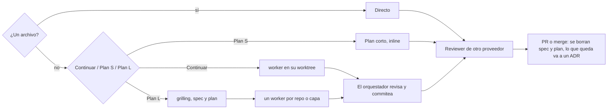

# agents-config

Un solo repo que configura igual a todos los agentes de código (Claude Code, Codex CLI, Cursor y Google Antigravity),
más una biblioteca de skills compartida que cada agente carga solo cuando la tarea la pide. Lo personal (nombre, idioma,
rutas, etapa de aprendizaje, owner de GitHub) va únicamente en `config/profiles/<name>.md`; el resto se comparte tal cual.

## Instalación

Elegí **un** método por máquina: se pisan entre sí y no se combinan.

```bash
# 1. install.sh: instrucciones, reglas, hooks, subagentes, skills y settings.json
git clone https://github.com/LorenGrz/agents-config ~/projects/agents-config
~/projects/agents-config/install.sh --dry-run          # muestra el plan, no cambia nada
~/projects/agents-config/install.sh --profile <tu-nombre>
```

`install.sh` genera `~/.claude/CLAUDE.md` y `~/.codex/AGENTS.md`, enlaza reglas, hooks, subagentes y `~/.agents/skills`, corre
`sync.sh` y mergea `config/settings.base.json` en `~/.claude/settings.json`. Nunca borra un archivo real: lo mueve a
`.bak.<timestamp>`. Opcionales: `--with-integrations`, `--with-cli-baselines`, `--with-rulesync`, `--with-rtk`,
`--org <name> <git-url>`; detalle en [config/README.md](config/README.md). También podés pedir «instalá este repo»
en una sesión abierta en el clon (skill `agents-config-setup`).

Requisitos: bash 4+, `jq` y GNU sed/awk/xargs/tar (macOS: `brew install bash gnu-sed gawk findutils gnu-tar`).

```bash
# 2. Marketplace de Claude Code: skills globales, subagentes y hooks genéricos; sin reglas, archivos generados ni merge
claude plugin marketplace add LorenGrz/agents-config
claude plugin install agents-config@agents-config
```

## Cómo se trabaja

Un cambio puntual (un archivo, intención clara) se hace directo. Con más de un archivo o alcance dudoso, el agente hace
una sola pregunta con tres opciones, siempre en este orden (`lane-guard.sh` lo impone):

| Lane | Qué es |
|---|---|
| Continuar | directo, sin plan |
| Plan S | plan corto (archivos, cambio, check) ejecutado inline; sin entrevista, solo las preguntas críticas en un lote |
| Plan L | entrevista de `mattpocock-skills:grilling`, spec y plan en `docs/superpowers/`, un worker por repo o capa en paralelo |

- **Orquestador**: la sesión principal. Escribe los briefs, revisa el diff, integra y commitea; en Plan L no escribe código.
- **`worker`**: implementa algo ya decidido, en segundo plano y en su worktree. Default para todo cambio no trivial.
- **`reasoner`**: decisiones caras de errar (arquitectura, bugs sin causa conocida, cambios difíciles de revertir).
- **`scout`**: búsquedas de solo lectura.
- **Reviewer**: otro proveedor revisa el diff contra el pedido y corre los checks, sin editar, antes de cada PR y del
  merge que cierra un Plan L. Una sola re-revisión; si no está, revisa el reemplazo del perfil (`review-handoff`).



| Harness | `worker` | Reviewer |
|---|---|---|
| Claude Code | subagente `worker` con `run_in_background` | `gemini-delegate` |
| T3 Code | `delegate_task` con `isolation: "worktree"` | `delegate_task` |
| Orca | workers de Orca (skill `orchestration`) | worker de Orca |

El modelo de cada rol lo define tu perfil («Model routing»). Un agente lanzado con un brief lo ejecuta, sin preguntar la
lane. Reglas: `config/AGENTS.md` («Workflow lanes»), `config/CLAUDE.md` («Agent Routing»), ADR 0022, 0029, 0033 y 0034.

## Capas

- **Global** (este repo): `config/` y `skills/`, instalados en la máquina. Ver [config/README.md](config/README.md).
- **Organización**: el repo privado de cada empleador o cliente, clonado en `organizations/<name>/` y nunca versionado
  acá. Suma políticas, skills y comandos; nunca relaja `config/baseline.md`. Ver [organizations/README.md](organizations/README.md).
- **Proyecto**: `project-init` arma un repo (`AGENTS.md`, hooks, CI) o documenta uno existente; `project-agents.sh` le
  instala skills, reglas, MCP y packs de su stack y su org. Va en todo repo con un segundo commit o un PR: las
  instrucciones solo guían, el lint, los hooks y la CI se cumplen igual.

## Estructura del repo

```
AGENTS.md, install.sh, sync.sh   mapa para agentes; instalación; espejo plano de skills en ~/.claude/skills
config/                instrucciones, baseline, perfiles, reglas, hooks, subagentes, settings base
skills/<category>/     la biblioteca de skills
packs/, organizations/ packs por arquitectura (ADR 0014); contrato y plantilla de org (sus repos, fuera de git)
scripts/               project-agents.sh, orgs.sh, gen-*.sh, lint-docs.sh, leak-guard.sh, test-*.sh
hooks/, .claude-plugin/  el plugin; gen-plugin.sh genera hooks/hooks.json y las skills de plugin.json
docs/decisions/        ADRs de este repo; evals/: evals de activación de skills
.agents/CONTEXT.md     estado actual, para agentes; .githooks/: leak guard en commit y push
```

## Comandos frecuentes

```bash
./sync.sh                              # tras agregar o mover una skill
scripts/gen-plugin.sh && scripts/gen-intents.sh   # plugin.json, hooks.json, intents.json, Shortcuts (--check en CI)
bash scripts/lint-docs.sh --strict     # plantillas de skills, reglas y comandos de packs
scripts/leak-guard.sh --all            # nada de una organización privada en el repo público
git config core.hooksPath .githooks    # activa la guarda en cada commit y push
for t in leak-guard packs orgs intents cli-baselines install-blocks lane-guard worktree-cleanup stack-sync; do bash scripts/test-$t.sh; done
```

## Problemas comunes

| Síntoma | Qué mirar |
|---|---|
| Una skill no se activa | `/context` para ver qué cargó; que su `description` coincida con la tarea; `./sync.sh` si es nueva |
| Reglas o hooks viejos | `./install.sh` los vuelve a enlazar; `ls -l ~/.claude/rules` y `readlink ~/.claude/hooks` |
| Un hook no corre | `/hooks` para ver los registrados; `~/.claude/logs/instructions-loaded.log` muestra qué cargó y cuándo |
| `settings.json` quedó mal | el `.bak.<timestamp>` al lado: `install.sh` siempre hace backup antes de escribir |

## Dónde seguir

[config/README.md](config/README.md) · [skills/README.md](skills/README.md) · [organizations/README.md](organizations/README.md) · [docs/decisions/README.md](docs/decisions/README.md)

## Créditos

[obra/superpowers](https://github.com/obra/superpowers) (flujo por specs y formato de skill) · [trailofbits/claude-code-config](https://github.com/trailofbits/claude-code-config)
(hooks y barandas) · [affaan-m/ECC](https://github.com/affaan-m) (convenciones de config) · [rtk-ai/rtk](https://github.com/rtk-ai/rtk)
(reducción de tokens) · [dyoshikawa/rulesync](https://github.com/dyoshikawa/rulesync) (reglas y skills para varias IA).
